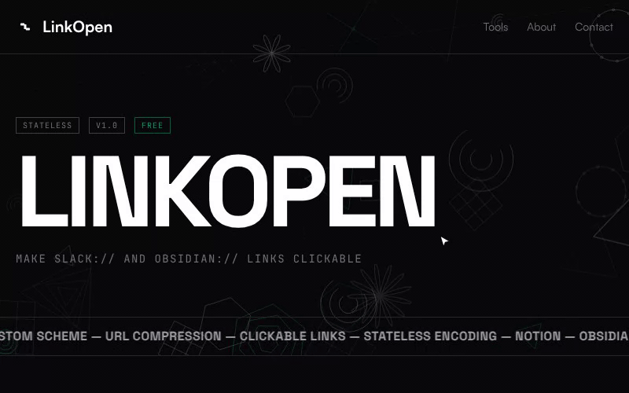
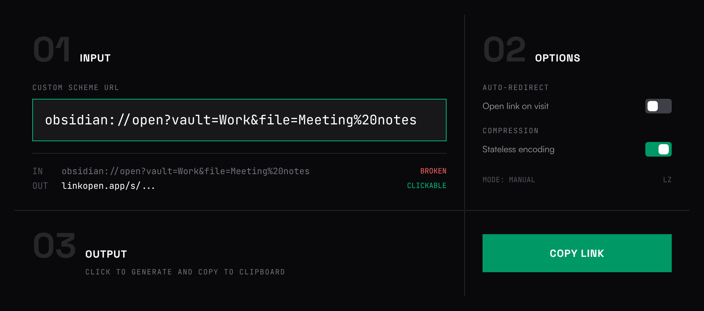

# LinkOpen

[](https://linkopen.app/s/1G4Zwxg9gJgpgXAegaSsB0BzAlgFwWAGwgDsYB.AVwCcCBeACxxwAcQBSAZgEE2AmAMT79sOehQBGaSAFshWYgSwAzGEJDMAHkA)

[LinkOpen](https://linkopen.app) turns app links like `slack://`, `obsidian://`, `vscode://` and `zoommtg://` into https links. Notion, GitHub, Gmail, Slack and many wikis don't make links like these clickable, so an app link pasted there ends up as plain text. A LinkOpen link is a normal https link. When someone clicks it, a page on linkopen.app passes the original link to the app. It's free, needs no account, and the code is in this repo.



## Example

Before. GitHub drops the link and shows plain text:

[Meeting notes](obsidian://open?vault=Work&file=Meeting%20notes)

After. The same note through LinkOpen:

[Meeting notes](https://linkopen.app/s/1kAHHUPYE4NaPAHCyBTBAXAlgOwOYFIBMAGdMZBAZyA)

```
obsidian://open?vault=Work&file=Meeting%20notes
https://linkopen.app/s/1kAHHUPYE4NaPAHCyBTBAXAlgOwOYFIBMAGdMZBAZyA
```

## How it works

- The link carries the URL. Common pieces such as `obsidian://open?vault=` or `https://github.com/` are swapped for single characters from a small dictionary, then the result is compressed with [LZ-string](https://github.com/pieroxy/lz-string) into URL-safe text. See [`utils/codec.js`](utils/codec.js).
- There is no database. Nothing is saved when you make a link, and links don't expire.
- Opening a link loads a page on linkopen.app that decodes the URL and hands it to the app. Auto links (`/s/1…`) open the app right away. Manual links (`/s/0…`) show an Open link button first.
- Links to websites (http and https) always get the confirmation page, never an automatic redirect. `javascript:`, `data:` and `vbscript:` links are refused. See [`utils/link-policy.js`](utils/link-policy.js).
- When compression wouldn't make a link shorter, the converter uses the plain form `https://linkopen.app/1/<url-encoded link>` instead.



## What's on the site

- [Converter](https://linkopen.app): paste a link, pick auto or manual, copy the result.
- [Tools](https://linkopen.app/tools): a URL compatibility checker, a deep link builder, a Markdown link generator and a list of URL schemes for common apps.
- [Obsidian guide](https://linkopen.app/obsidian-links): how to share links to notes in a vault.

New in this release:

- README badges: `https://linkopen.app/badge/<app>.svg`, with a builder at [/tools/readme-badge](https://linkopen.app/tools/readme-badge). The badge at the top of this file is one.
- Link API: `GET https://linkopen.app/api/link?url=…&mode=auto|manual` returns the same link the converter makes.
- [Integrations](https://linkopen.app/integrations): Apple Shortcuts, Raycast and the shell.
- Obsidian plugin. Source in [`integrations/obsidian-plugin`](integrations/obsidian-plugin).

## Privacy

There's no database and no accounts. The URL lives inside the link, so LinkOpen has nothing to store. It is compressed, not encrypted: anyone who has the link can read the URL in it.

The site uses Google Analytics and Vercel Analytics. They record page addresses, and the address of a shared link contains the encoded URL. Google Analytics also sets cookies to count visits.

## Development

```
npm install
npm run dev
npm test
```

`npm run dev` starts Next.js on http://localhost:3000. The stack is Next.js 15 (app router), React 19 and Tailwind CSS 4. Before you change the dictionary in `utils/codec.js`, read the comment above it: existing entries must never change, or old links stop working.

## Name

This started as SPX (scheme proxy), was renamed Shortlink at shortlink.studio, and is now LinkOpen. Old shortlink.studio links redirect to linkopen.app.

## License

MIT. See [LICENSE](LICENSE).
